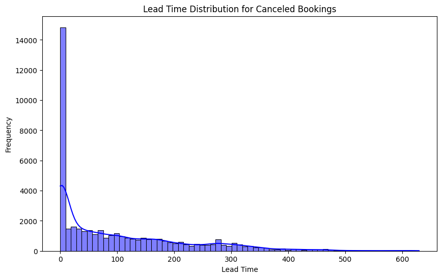
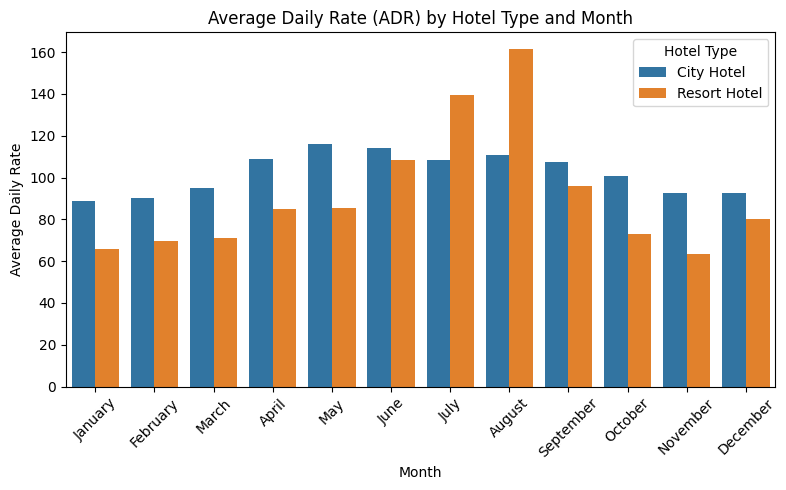
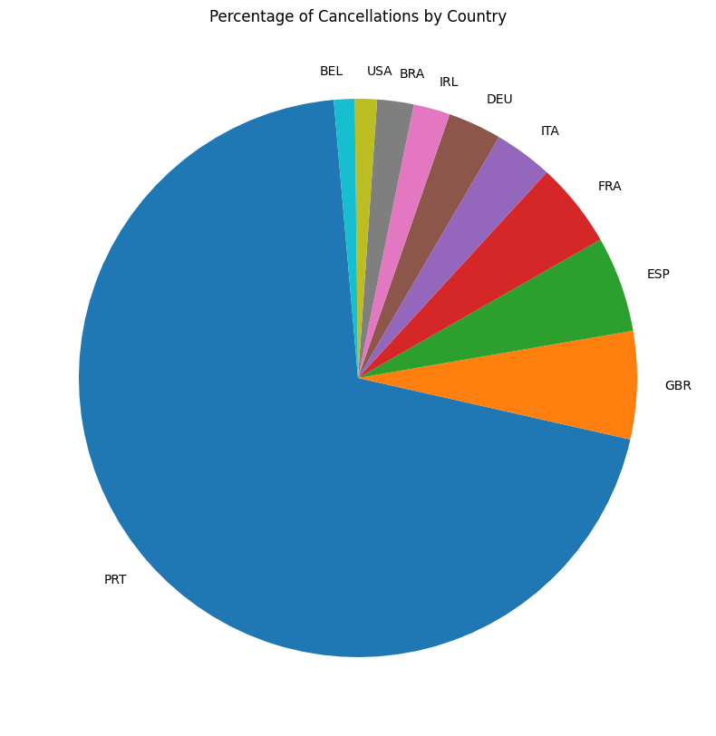
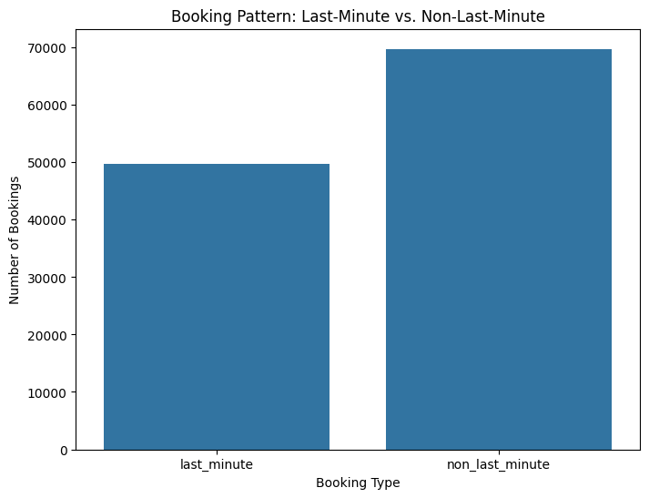
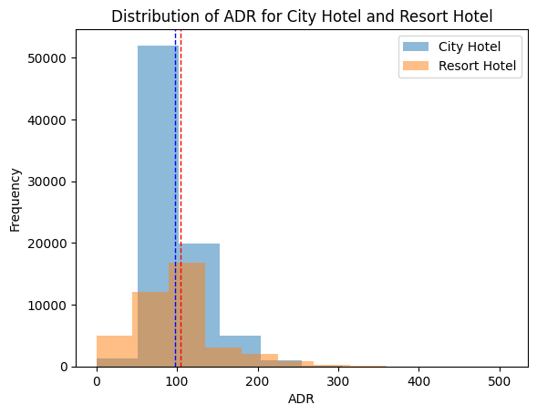

# 🏨 Hotel Booking Demand & Cancellation Analysis
### End-to-End Exploratory Data Analysis, SQL CTE Modeling, and Statistical Hypothesis Testing

[](https://www.python.org/)
[](https://pandas.pydata.org/)
[](https://seaborn.pydata.org/)
[](https://www.sqlite.org/)
[](https://scipy.org/)
[](https://opensource.org/licenses/MIT)

---

## 📌 Executive Summary

High booking cancellation rates present a persistent challenge to the hospitality industry, leading to operational inefficiencies, inventory misallocation, and revenue loss. This project performs an **end-to-end data analytics and business intelligence study** on a benchmark dataset of **119,390 hotel booking records** across City and Resort hotels.

Using **Python, Pandas, Seaborn, SQL (SQLite with CTEs), and SciPy**, we evaluate customer booking behaviors, cancellation determinants, seasonal price elasticity (Average Daily Rate / ADR), geographic risk factors, and inferential hypothesis testing.

---

## 🎯 Business Problems & Research Questions

1. **Cancellation Dynamics**: What is the baseline cancellation rate across hotel categories and years, and what customer characteristics signal a high cancellation risk?
2. **Lead Time Volatility**: How does the booking horizon (lead time) impact the probability of cancellations and daily room rates?
3. **Revenue Seasonality**: Are there distinct seasonal pricing disparities between City Hotels and Resort Hotels?
4. **Geographic Risk Profiling**: Which international markets contribute the most significant cancellation volume?
5. **Statistical Significance**: Is the observed ADR disparity between City Hotels and Resort Hotels statistically significant or a result of random variance?

---

## 📊 Key Highlights & Findings at a Glance

| Metric | City Hotel | Resort Hotel | Overall / Impact |
| :--- | :---: | :---: | :--- |
| **Total Dataset Size** | 79,330 bookings | 40,060 bookings | **119,390 records** across 37 features |
| **Cancellation Rate** | **~41.8%** | **~27.8%** | City Hotel cancellations are **~1.5x higher** |
| **Mean Daily Rate (ADR)** | **$104.41** | **$97.18** | Statistically significant difference ($t = 29.43, p < 0.001$) |
| **Average Lead Time** | 109.7 days | 92.7 days | Long lead times (>100 days) heavily correlate with cancellations |
| **Top Cancellation Market**| Portugal (PRT) | Portugal (PRT) | **27,519 cancellations** originated from Portugal alone |
| **Peak Revenue Date** | August 17, 2017 | August 17, 2017 | **$3,064.80** daily ADR for completed bookings (>2 special requests) |

---

## 🛠️ Data Preprocessing & Cleaning Pipeline

Before conducting exploratory and statistical modeling, the raw data underwent rigorous hygiene processing:

1. **Duplicate Elimination**: Verified row-level consistency and deduplicated redundant records.
2. **Missing Value Imputation**:
   - `children`: Imputed with `0` (null records treated as zero minors).
   - `country`: Imputed with `'Unknown'` to retain record integrity for domestic vs international filtering.
   - `adr` (Average Daily Rate): Imputed remaining nulls with mean distribution.
3. **Anomaly Rectification**:
   - Filtered and zeroed negative rate anomalies (e.g., `-6.38` adjusted to `0.0`).
4. **Categorical Standardization**:
   - Mapped non-standard categorical entries (`Undefined` meal mapped to `SC` — Self Catering).

---

## 📈 Exploratory Data Analysis & Visual Insights

### 1. Lead Time Distribution vs. Booking Cancellation
Bookings with extended advance notice exhibit a significantly elevated cancellation probability. Customers booking more than 90–120 days in advance tend to treat reservations as tentative options rather than firm commitments.



> **Key Takeaway**: Short-horizon bookings (<7 days) demonstrate the lowest cancellation risk. As lead time increases past 30 days, cancellation risk surges past 40%.

---

### 2. Seasonal Revenue & Pricing Patterns (City vs. Resort)
Analyzing monthly Average Daily Rate (ADR) reveals distinct demand drivers across hotel segments:



> **Key Takeaway**: 
> - **Resort Hotels** experience sharp seasonal surges, peaking in **July and August** (summer vacation season, reaching ADR > $180).
> - **City Hotels** maintain relatively stable pricing year-round ($95–$120) with peak business activity in **May and September**.

---

### 3. Geographic Cancellation Concentration
Analyzing cancellations by guest country of origin highlights extreme geographic clustering:



| Rank | Country Code | Market | Total Cancellations |
| :---: | :---: | :--- | :---: |
| 1 | **PRT** | Portugal | **27,519** |
| 2 | **GBR** | United Kingdom | **2,453** |
| 3 | **ESP** | Spain | **2,177** |
| 4 | **FRA** | France | **1,934** |
| 5 | **ITA** | Italy | **1,333** |
| 6 | **DEU** | Germany | **1,218** |

> **Key Takeaway**: Local/domestic Portuguese bookings account for **over 62% of all cancellations**, driven by flexible cancellation terms in domestic distribution channels.

---

### 4. Last-Minute Booking Behavior
Reservations completed within 7 days of arrival (`last_minute_threshold = 7`) demonstrate unique consumer patterns:



> **Key Takeaway**: Last-minute travelers generate higher completion rates (>85% completed) with minimal special requests, representing high-certainty revenue opportunities.

---

## 💾 Advanced SQL Analytics (CTEs & Aggregations)

To replicate an enterprise analytics workflow, cleaned data was ported into an in-memory SQL relational database using `SQLAlchemy` and `SQLite`:

### A. Annual Cancellation Rate by Hotel Type
```sql
SELECT 
    hotel, 
    arrival_date_year, 
    ROUND(SUM(is_canceled) * 100.0 / COUNT(*), 2) AS cancellation_rate
FROM hotel_bookings_clean
GROUP BY hotel, arrival_date_year
ORDER BY hotel, arrival_date_year;
```
* **Result**: City Hotel consistently maintained cancellation rates between **40.4% and 43.9%** across 2015–2017, whereas Resort Hotel remained in the **25.7% – 28.5%** range.

### B. Lead Time Categorization vs. ADR Yield (CTE)
```sql
WITH LeadTimeCTE AS (
    SELECT
        CASE
            WHEN lead_time BETWEEN 0 AND 30 THEN '0-30 Days'
            WHEN lead_time BETWEEN 31 AND 60 THEN '31-60 Days'
            WHEN lead_time BETWEEN 61 AND 90 THEN '61-90 Days'
            ELSE '91+ Days'
        END AS lead_time_range,
        adr
    FROM hotel_bookings_clean
)
SELECT 
    lead_time_range, 
    ROUND(AVG(adr), 2) AS average_adr
FROM LeadTimeCTE
GROUP BY lead_time_range
ORDER BY average_adr DESC;
```
* **Result**: Bookings made in the **31–60 days** and **61–90 days** windows generated the highest average daily rates ($105.40 & $105.17), outperforming immediate bookings ($101.18).

---

## 🔬 Inferential Statistics: Hypothesis Testing

To validate whether the pricing difference between City Hotels and Resort Hotels is statistically significant, we conducted a **Two-Sample Independent Student's T-Test**:

### Hypotheses Formulation
- **Null Hypothesis ($H_0$)**: $\mu_{\text{City Hotel ADR}} = \mu_{\text{Resort Hotel ADR}}$ (There is no significant difference in mean ADR between hotel types).
- **Alternative Hypothesis ($H_1$)**: $\mu_{\text{City Hotel ADR}} \neq \mu_{\text{Resort Hotel ADR}}$ (The mean ADR differs significantly).



### Test Results
- **City Hotel Mean ADR**: **$104.41**
- **Resort Hotel Mean ADR**: **$97.18**
- **T-Statistic**: **29.431**
- **P-Value**: **$0.00000$ ($p < 0.001$)**

### Conclusion
Because $p < 0.05$, we **reject the Null Hypothesis ($H_0$)**. There is statistically significant empirical evidence that City Hotels command a higher average daily rate than Resort Hotels across the complete operating period.

---

## 💡 Strategic Business Recommendations

Based on empirical data and statistical validation, hotel revenue and commercial management should implement the following strategic measures:

1. **Tiered Non-Refundable Deposit Policy**:
   - Enforce mandatory non-refundable deposits for reservations with **lead times exceeding 30 days**, particularly in domestic channels (Portugal/Southern Europe).
2. **Calibrated City Hotel Overbooking Buffer**:
   - Establish an algorithmic **15–20% overbooking capacity** for City Hotels during peak weekdays to offset the consistent ~41% cancellation rate without risking walk-aways.
3. **Resort Hotel Peak Season Yield Management**:
   - Exploit summer holiday elasticity by unbundling premium packages (spa, meals, wellness) during July–August when ADR tolerance exceeds $180.
4. **Automated Pre-Arrival Engagement**:
   - Implement scheduled automated email/WhatsApp re-confirmation checkpoints at **Day 30, Day 14, and Day 7** prior to check-in to identify unconfirmed bookings early.

---

## 🚀 Repository Structure

```plaintext
├── assets/
│   ├── adr_monthly_trend_hotel_types.png
│   ├── hypothesis_testing_adr_comparison.png
│   ├── last_minute_booking_behavior.png
│   ├── lead_time_distribution_canceled.png
│   └── top_countries_cancellation.png
├── Hotel_Booking_Data_Analysis.ipynb    # Complete reproducible Jupyter Notebook
├── requirements.txt                    # Project environment dependencies
├── .gitignore                          # Clean repository ignore file
└── README.md                           # Comprehensive documentation & findings
```

---

## 💻 Getting Started

### 1. Clone the Repository
```bash
git clone https://github.com/0xErs/Hotel-Booking-Data-Analysis.git
cd Hotel-Booking-Data-Analysis
```

### 2. Set Up Virtual Environment & Dependencies
```bash
python -m venv venv
# Windows:
venv\Scripts\activate
# Linux/macOS:
source venv/bin/activate

pip install -r requirements.txt
```

### 3. Launch the Jupyter Notebook
```bash
jupyter notebook Hotel_Booking_Data_Analysis.ipynb
```

---

## 👤 Author

**Erwin Setiawan**
- **Degree**: Bachelor of Informatics Engineering (S.Kom), *Cum Laude*
- **Role**: Data Analyst / Business Intelligence
- **LinkedIn**: [linkedin.com/in/erwinsetiawan046](https://www.linkedin.com/in/erwinsetiawan046/)
- **GitHub**: [github.com/0xErs](https://github.com/0xErs)
- **Portfolio**: [0xers.github.io](https://0xers.github.io/)
- **Email**: [erwinsetyawan37@gmail.com](mailto:erwinsetyawan37@gmail.com)
